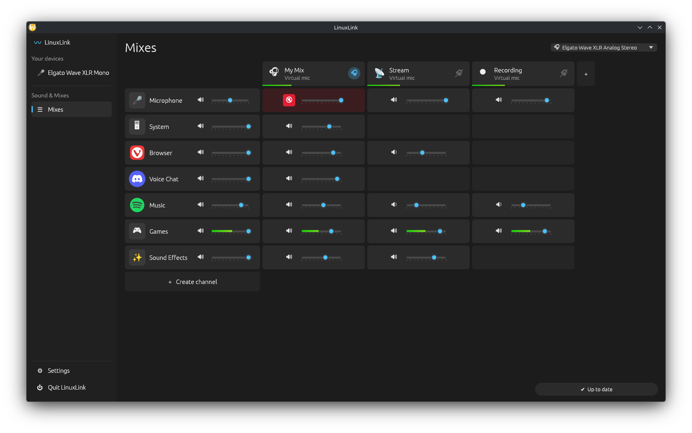
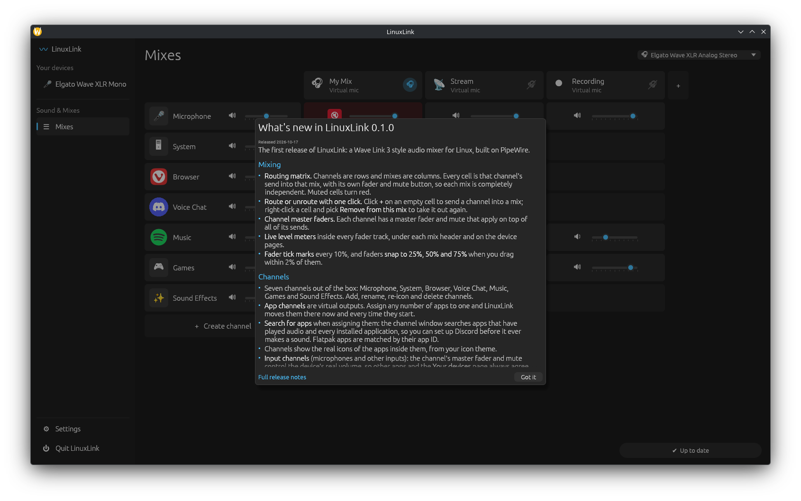

# User guide

LinuxLink is built around two ideas: **channels** and **mixes**.

- A **channel** is a source of sound: a group of apps (Music, Games, Voice
  Chat…) or an input device such as your microphone.
- A **mix** is a combination of channels, each at its own volume. You might
  hear one mix in your headphones while your stream or recording gets another.

The main screen, **Mixes**, is a matrix: channels are rows, mixes are columns.

## Channels

The first column of each row is the channel itself:

- Its **icon** shows the apps in it. Click the icon or name to open the
  channel's settings.
- The **speaker button** mutes the whole channel.
- The **fader** is the channel's master volume. It applies on top of every
  mix. For an input channel (your microphone), it is the device's real volume.

### Putting apps in a channel

1. Click the channel's name.
2. Under **Apps in this channel**, tick the apps you want. Use the **search
   box** to find any installed application, even one that has never played
   sound.
3. Click **Done**.

LinuxLink moves the app there right away, and every time it starts from then
on. Apps that aren't in any channel play through the channel chosen in
**Settings → General → System default output** (System, by default).

An app can only be in one channel; ticking it in another channel moves it.

### Creating, renaming and deleting channels

- **Create channel** (below the last row) lists your input devices and apps:
  pick one to make a channel for it (an app's channel is named after it and
  plays it from then on), or choose **Add empty channel** to start from
  scratch.
- In a channel's settings you can rename it, pick an icon, choose the input
  device (for input channels), **Boost** it by up to 12 dB in every mix (for a
  quiet app or microphone), hide it, or **Delete channel**.
- Right-click a channel's name to **Move up**, **Move down** or **Hide** it.
  Hidden channels keep playing; the **👁 hidden channels** button below the
  last row shows them again.

## Mixes

Each column is a mix. The header shows its name and icon, its level meter, and
on the right the **🎧 listen toggle**.

- **🎧 on (blue):** you hear this mix on your listening device.
- **🎧 off (crossed out):** you don't hear it, but it keeps working for
  anything recording it.

Any number of mixes can be on at once. Choose your **listening device**
(headphones or speakers) in the top-right corner. You can also just pick an
output in your desktop's volume controls: LinuxLink follows, moving your mixes
there while apps keep playing through your channels. If the listening device
is disconnected, LinuxLink switches to the most recently connected Bluetooth
headset, else your previous output. A Bluetooth headset you connect becomes
your listening device automatically.

### The cells

Each cell is one channel's volume *in that mix*:

- Drag the fader to set the volume. Like Wave Link's, faders are linear in
  decibels: the right end is full volume (0 dB), the middle is −30 dB, and
  the left end is silence. Hover a fader to see its value. Faders snap to
  −45, −30 and −15 dB.
- Click the speaker to mute the channel in this mix only. Muted cells turn red.
- An empty cell means the channel isn't in that mix. Click **+** to add it;
  right-click a cell and choose **Remove from this mix** to take it out.
- **↓** means voice ducking lowers the channel in this mix (blue while it's
  ducking). **⚠** on a microphone means you listen to this mix, so you'll
  hear yourself slightly delayed; mute it there if that bothers you.

The **Mix volume** row under the headers sets each mix's overall volume.

### Mix settings

Click a mix's header to rename it, choose an icon, turn listening on or off, or
send it to **extra outputs** (for example a capture card or a second headset).
Each output device plays at most one mix. You can have up to five mixes; add
one with the **+** next to the last header. Right-click a header to move the
mix left or right.

### Compact view

**🗗 Compact view** (next to the listening device) shrinks the window to one
mix: pick the mix at the top, and each channel gets a mute and fader for it.
**⛶ Full view** brings the full mixer back. LinuxLink remembers the view.

## Voice ducking

Ducking lowers some channels while another is loud: typically music and games
go down while you talk, so your stream or call hears you clearly. Set it up in
**Settings → Voice ducking**:

- **Triggered by:** the channels that cause ducking (your microphone by
  default; Voice Chat works too, to hear your friends over the game).
- **Sensitivity:** higher reacts to quieter sound.
- **Amount:** how far the other channels go down: 6, 12 or 24 dB.
- **Speed:** how quickly ducking starts and stops.
- **Duck these channels:** tick a channel under each mix it should be lowered
  in. You might duck music in Stream only, and keep it steady in My Mix.

Ducking works whether the window is open or LinuxLink runs in the tray.

## Using a mix in OBS, Discord and other apps

Every mix is also a virtual microphone named **LinuxLink *mix name***, for
example *LinuxLink Stream*.

- **OBS:** add an *Audio Input Capture* source and choose *LinuxLink Stream*.
- **Discord:** *User Settings → Voice & Video → Input Device → LinuxLink Stream*.
- **Recording apps:** pick the mix as the input device.

A common setup: your microphone, game and music in **Stream**, your voice chat
and everything else in **My Mix**, with 🎧 on for My Mix only.

## How LinuxLink recognizes apps

Audio streams don't always say which app they belong to: Discord's calls are
called "WEBRTC VoiceEngine", Steam's are "Chromium", and Proton games report
their Windows program name ("deadlock.exe"). LinuxLink matches each stream to
the app's menu entry for its real name and icon:

- **Flatpak apps** by their app ID.
- **Steam games** by their Steam menu entry, so a game shows up once, with its
  Steam name and icon, whether Steam or Proton plays its audio.
- **Other apps** by their program name, menu entry or window class.
- Your desktop's notification and feedback sounds are grouped as
  **System sounds**.

Apps without a menu entry are shown with the name their stream reports. When
you put an app in a channel, LinuxLink remembers it by this identity, so the
choice keeps working across restarts and updates.

## Bluetooth headsets

- **Connecting a headset makes it your listening device**, like on a phone:
  your mixes move to it automatically.
- **If it disconnects**, LinuxLink carries on with the most recently connected
  other headset, else your previous output, so you're never left with silence.
- If a Bluetooth connection fails mid-stream (it happens: "Failure in Bluetooth
  audio transport"), LinuxLink notices and reconnects within a few seconds.
- Bluetooth adds noticeable delay; that's the headset, not LinuxLink.

## Mouse and keyboard

| Action | Does |
| --- | --- |
| Click a channel's icon or name | Opens the channel's settings (apps, name, icon, input device) |
| Click a mix's header | Opens the mix's settings (name, icon, extra outputs) |
| Click 🎧 on a mix header | Turns hearing that mix on or off |
| Click **+** on an empty cell | Adds that channel to that mix |
| Right-click a cell | **Remove from this mix** |
| Right-click a channel's name | **Move up**, **Move down**, **Hide channel** |
| Right-click a mix's header | **Move left**, **Move right** |
| Click a speaker button | Mutes or unmutes (red means muted) |
| Drag a fader | Sets the volume; snaps to −45, −30 and −15 dB when close |
| Search box in a channel | Type to find any installed app |
| Left-click the tray icon | Opens the window |
| Right-click the tray icon | **Open LinuxLink** / **Quit** |

## Your devices

The sidebar lists your input devices. Click one to set its gain, mute it, watch
its level, or **Add as channel**.

## Settings

Settings has a tab for each area, like Wave Link's:

- **General:** the **color theme** (same as your desktop, light or dark),
  starting with your computer, whether closing the window keeps LinuxLink
  running, which channel apps play through by default, latency (lower is
  snappier; raise it if you hear crackling), and **Quit LinuxLink**.
- **Listening:** your listening device and which mixes you hear.
- **Voice ducking:** see [Voice ducking](#voice-ducking).
- **Devices:** switch off devices you never use to hide them from LinuxLink.
  Turn on **Turn them off on this computer too** to remove them from your
  system's sound settings and other apps as well.
  Other apps can still use them.
- **Control API:** lets programs on this computer control LinuxLink (see
  [configuration.md](configuration.md#control-api)). Websites can't use it.
- **Updates:** the update status, and **What's new**.
- **About:** links to the project and to report a problem.

## Closing, the tray and starting with your computer

LinuxLink has to keep running for your channels and mixes to work. Closing the
window (X) therefore closes only the window: LinuxLink keeps running, with an
icon in the system tray, and your audio keeps working. To get the window back,
click the tray icon, choose **Open LinuxLink** from its menu, or start
LinuxLink from your app menu again. To quit for real, right-click the tray
icon and choose **Quit**, or use **Quit LinuxLink** in **Settings →
General**.

If your desktop has no system tray, closing the window minimizes it to the
taskbar instead, so LinuxLink can't get lost.

**Start with your computer** (Settings → General) starts LinuxLink in the tray
when you log in, without opening the window.

When LinuxLink quits, it removes all of its virtual devices and leaves your
system playing on the device you were listening on.

To quit when the window is closed instead, turn off **Settings → General →
Keep running when closed**.

## Updates

**Settings → Updates** shows whether you're up to date. When a new version is
out, a **Download new update** button also appears in the lower-right corner:

| Installed as | What happens |
| --- | --- |
| AppImage, tarball | Downloads and installs in the background; click **Restart to update** |
| .deb, .rpm, Flatpak | Downloads the package to ~/Downloads and opens your system installer |
| Arch package | Opens the release page; update with pacman or your AUR helper |

Every download is checked against the release's SHA256SUMS before it's used.
After an update, a **What's new** window lists the changes:

## Your settings

Everything you set up is saved automatically in
`~/.config/linuxlink/config.toml` (Flatpak:
`~/.var/app/io.github.Okaza03.LinuxLink/config/linuxlink/config.toml`) and
restored when LinuxLink starts again, including after a reboot.

To start over, quit LinuxLink and delete that file. Every setting is described
in the [configuration reference](configuration.md).

## More

- [Setups](setups.md): step-by-step recipes for OBS, Discord, recording and
  more.
- [Installing, updating and removing](installing.md)
- [FAQ](faq.md) and [troubleshooting](troubleshooting.md)
